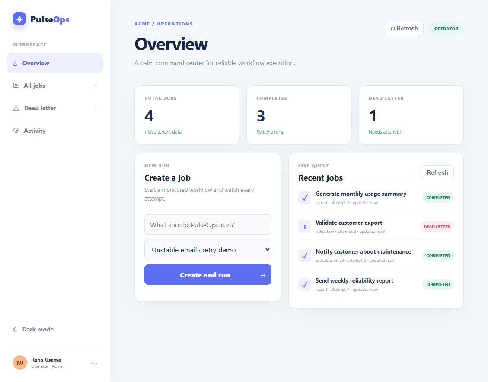

# Job Reliability Dashboard

Multi-tenant workflow operations dashboard built with Django REST Framework, React, and Redux Toolkit.

Each tenant sees only its own jobs. Operators can create and retry jobs; viewers can inspect jobs and events.

## Run the backend

    python -m venv .venv
    .\.venv\Scripts\Activate.ps1
    pip install -r requirements.txt
    python manage.py migrate
    python manage.py runserver

The API is available at http://127.0.0.1:8000/api/. Send X-Tenant-Id and X-User-Role headers. Roles are operator and viewer.

## Run the frontend

    cd frontend
    npm install
    npm run dev

The dashboard includes tenant-scoped job counts, recent jobs, tool selection, status badges, and idempotent job creation.

## API capabilities

All API calls require `X-Tenant-Id` and `X-User-Role` (`operator` or `viewer`) in the local demo. Operators can create and retry jobs; viewers have read-only access. For non-debug deployments, set `PULSEOPS_API_KEYS` and send `Authorization: Bearer <key>`; the server derives the tenant and role from that key instead of trusting request headers.

```text
GET  /api/jobs/?status=dead_letter&search=export&page_size=20
GET  /api/jobs/stats/
GET  /api/jobs/<id>/timeline/
POST /api/jobs/<id>/retry/
GET  /health/
```

Job creation is idempotent per tenant and idempotency key. A duplicate request returns the original job without executing another attempt.

## Docker and asynchronous workers

For a production-shaped local stack (API, React, Redis, and a Celery worker):

    docker compose up --build

The dashboard is available at http://localhost:5173 and the API at http://localhost:8000. The regular Python/Vite commands remain available for a lightweight synchronous demo. Set `PULSEOPS_ASYNC_JOBS=true` when running a Celery worker-backed environment.

Copy `.env.example` to `.env` and replace the development secret before sharing a deployment.

To recreate the deterministic demo data locally:

    python manage.py seed_demo --tenant acme

## Dashboard preview

The PulseOps overview gives operators an at-a-glance view of tenant health, recent workflow runs, and dead-letter work that needs attention.

<p align="center">
  
</p>

The seeded workspace shown above contains **4 total jobs**, **3 completed runs**, and **1 dead-letter job**. The live queue also exposes the selected tool, current attempt, and final status for every run.

For a lightweight design preview, see [dashboard-screenshot.svg](docs/dashboard-screenshot.svg).

## Reliability model

Jobs, attempts, and workflow events are persisted separately. unstable_email fails once and can be retried, validation always fails and reaches the dead-letter state, and report succeeds. The tenant plus idempotency key prevents duplicate job creation.
